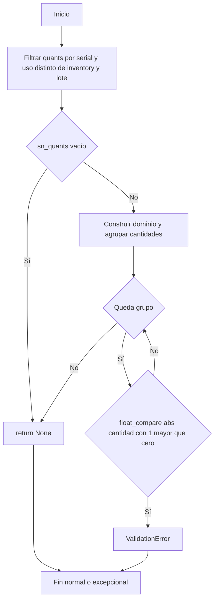

# Diseño de pruebas — Kevin Burgos — Entrega 2

Curso: Calidad de Productos de Software, Universidad del Valle.
Sistema: Odoo 18 Community, Inventario, base `calidad`.
Fecha: 2026-11-25. Técnicas: PE = partición de equivalencia; VL = valores límite.

## Alcance y fundamentos

Cuatro funciones pytest, con 14 escenarios parametrizados. Los RF-K son requisitos
de prueba definidos para este aporte, no identificadores oficiales de Odoo.
Se revisaron FC-01..08 en main y FC-05..12 de `origin/feature/daniel`:
ninguno evalúa códigos de barras, peso, volumen ni nombre de ubicación.
La creación de productos es una precondición, no la funcionalidad evaluada.

Preparación común: Inventory instalado, Chrome, usuario con permisos de producto
y ubicaciones, formulario en inglés, sin operaciones simultáneas sobre los datos
propios. XML-RPC prepara registros y verifica persistencia; Selenium realiza
todas las modificaciones evaluadas. Limpieza por IDs creados en cada escenario.
No se invocan directamente los métodos unitarios reservados por otros integrantes.

## FC-13 — Código de barras de producto

- **RF-K13:** permitir código nuevo o vacío y rechazar un código ya utilizado
  por otro producto en el mismo entorno.
- **Técnica:** PE: único, vacío y duplicado.
- **Precondición:** producto propio de tipo Goods, sin variantes adicionales.
  Para duplicado existe otro producto propio con el código; para vacío se guarda
  primero un código propio, evitando probar una edición sin cambios.
- **Entrada:** `KEVIN-<uuid>`, cadena vacía y código del segundo producto.
- **Pasos:** abrir ficha por acción de Inventario; editar Barcode; capturar;
  guardar; recargar si válido o inspeccionar diálogo si duplicado.
- **Esperado:** nuevo código persistido, campo vacío persistido o diálogo que
  identifica el código duplicado; en el rechazo el producto conserva Barcode vacío.
- **Evidencia:** `evidencia/test_FC13_codigo_barras[<clase>]/`.
- **Estado:** consultar registro de resultados de la ejecución real.

## FC-14 — Peso logístico

- **RF-K14:** conservar la edición del peso numérico en la pestaña Inventory.
- **Técnica:** PE (negativo, cero, positivo) y VL alrededor del cambio de signo,
  con paso de prueba de 0.01.
- **Precondición:** producto propio, peso inicial 2, ficha de una sola variante.
- **Entrada:** −0.01, 0, 0.01 y 1, escenarios independientes.
- **Pasos:** abrir ficha; Inventory; editar Weight; guardar; recargar; comprobar
  número visible y valor persistido.
- **Esperado:** valor introducido conservado en ambos lugares.
- **Evidencia:** `evidencia/test_FC14_peso[<valor>]/`.
- **Estado:** consultar registro de resultados.

## FC-15 — Volumen logístico

- **RF-K15:** conservar la edición del volumen numérico en Inventory.
- **Técnica:** PE y VL, mismas clases y frontera de signo que FC-14.
- **Precondición:** producto propio con volumen inicial 2.
- **Entrada:** −0.01, 0, 0.01 y 1.
- **Pasos:** Inventory; editar Volume; guardar; recargar; verificar UI y servidor.
- **Esperado:** valor introducido persistido, sin alterar la interpretación numérica.
- **Evidencia:** `evidencia/test_FC15_volumen[<valor>]/`.
- **Estado:** consultar registro de resultados.

**Interpretación FC-14/15:** se prueba un campo numérico firmado de Odoo, no se
inventa una prohibición contractual de negativos. El cero es frontera de signo,
no se afirma que sea un mínimo validado; 0.01 es el paso elegido, no la precisión
universal del campo. No se cubre máximo de magnitud ni transporte/valoración.

## FC-16 — Nombre obligatorio de ubicación

- **RF-K16:** rechazar nombre vacío y conservar nombres de uno y dos caracteres.
- **Técnica:** PE (vacío/no vacío) y VL de longitud 0/1/2.
- **Precondición:** ubicación interna propia, nombre inicial `KEVIN-<uuid>`,
  sin existencias ni movimientos.
- **Entrada:** `""`, `"K"`, `"KB"`.
- **Pasos:** abrir ubicación; sustituir nombre; guardar; observar campo requerido
  o recargar; verificar persistencia.
- **Esperado:** vacío marcado inválido y nombre anterior conservado en BD;
  K y KB guardados y mostrados tras recargar.
- **Evidencia:** `evidencia/test_FC16_nombre_ubicacion[<longitud>]/`.
- **Estado:** consultar registro de resultados.

## Diseño unitario: stock.quant.check_quantity

Fuente instalada: `/usr/lib/python3/dist-packages/odoo/addons/stock/models/stock_quant.py`,
líneas 609–625. La fuente completa se imprime en `evidencia/test_unit_kevin/salida.txt`.
No tiene decorador `constrains`: se invoca explícitamente el método real.
Su validación agrupa cantidades por producto, ubicación y lote y compara
`abs(sum(quantity))` con 1 usando redondeo de la unidad del producto.

### Grafo de flujo

Filtro en cortocircuito: A = tracking serial; B = usage distinto de inventory;
C = lote presente. A falso excluye sin evaluar B/C; B falso excluye sin C;
C falso excluye; todos verdaderos incluyen. El registro vacío no evalúa lambda.

### Complejidad y caminos

- Cuerpo del método: dos `if` y un `for`: **V(G)=3+1=4**.
  En el grafo con salida unificada: 9 nodos, 11 aristas, un componente;
  **E−N+2P = 11−9+2 = 4**.
- Convención ampliada contando los dos `and` del predicado lambda:
  **V(G)=4+2=6**. Se reportan ambas para no confundir sentencias con condiciones.
- Caminos básicos del cuerpo: salida temprana; un grupo válido y salida;
  repetición del bucle con varios grupos válidos; grupo inválido y excepción.
  El camino sintáctico con `sn_quants` no vacío pero cero grupos no es generable
  con quants persistidos visibles de estas precondiciones; no se falsifica con mocks.
- Los escenarios de exclusión ejercitan separadamente las alternativas del
  filtro. Se miden arcos del cuerpo, no MC/DC ni cobertura automática de lambda.

| Caso | Entrada / precondición | Camino / rama | Esperado |
|---|---|---|---|
| UK01 | tracking none, cantidad 2 | A falso, salida temprana | None, cantidad intacta |
| UK02 | serial con lote en inventory, cantidad 2 | B falso | None, cantidad intacta |
| UK03 | serial sin lote, cantidad 2 | C falso | None, sin lote |
| UK04 | tres productos/lotes con −1, 0 y 1 | filtro verdadero, comparación falsa, bucle repetido y salida | None, cantidades intactas |
| UK05 | dos subescenarios independientes −2 y 2 | comparación verdadera | ValidationError en ambos |
| UK06 | recordset vacío | filtro sin iteraciones, salida temprana | None |

Cada método `test_UKxx` cuenta una prueba unittest: seis pruebas, aunque UK04/05
incluyen varios valores. No son pruebas del recorrido completo de transferencias.
`TransactionCase` revierte datos con savepoints. El ejecutor devuelve salida 1
si hay fallos o si falta cobertura de las líneas/arcos definidos.

### Instrumentación

Se usa `sys.settrace` sobre el objeto de código real, sin reemplazarlo:
líneas ejecutadas intersectadas con sentencias AST; arcos de los dos `if` y el
`for`. Las listas multilínea evalúan su primer elemento antes de asignarse:
el arco falso del primer if termina en línea 614, no en 613.
Los números absolutos se calculan desde `inspect.getsourcelines`.
El JSON de salida conserva denominadores y arcos para auditar la medición.
