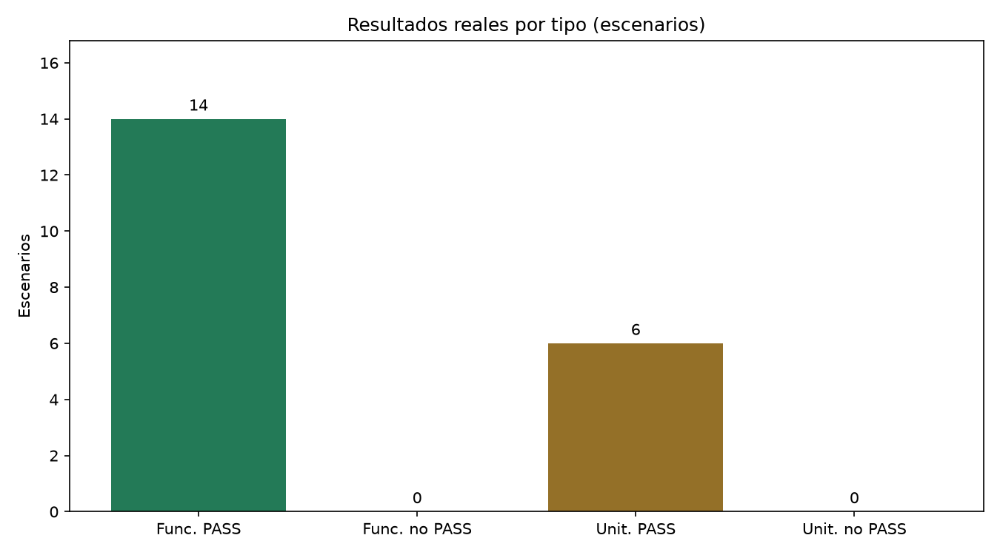
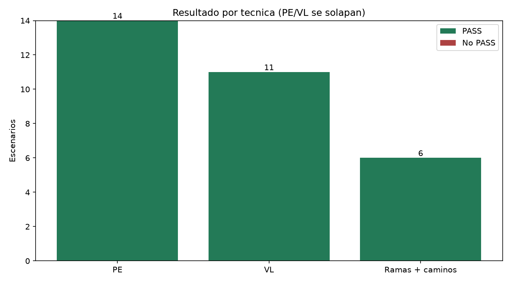
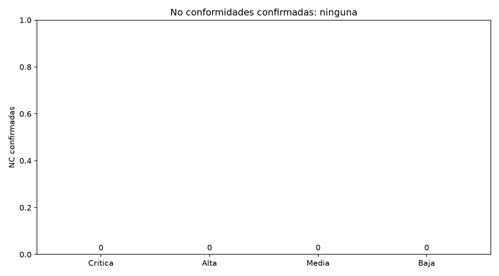
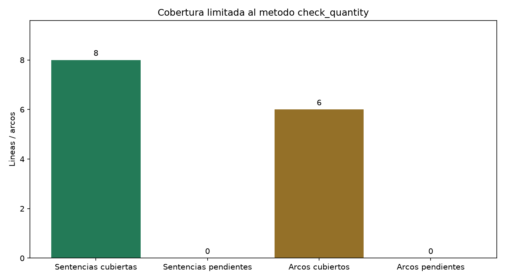

# Informe de pruebas — Kevin Burgos

Calidad de Productos de Software — Universidad del Valle.
Entrega 2 · Odoo 18 Community, Inventario · 2026-11-25.

## 1. Alcance, herramientas y reproducibilidad

Aporte: cuatro casos funcionales (FC-13..16), 14 escenarios parametrizados;
un método real `stock.quant.check_quantity`, seis pruebas TransactionCase.
Se aplicaron PE/VL en funcionales y ramas/caminos básicos en unitarias.
Inventario instalado en Docker, PostgreSQL 15, base calidad, stock 18.0.1.1.
Credenciales heredadas de `functional/conftest.py`, sin nuevas claves en código.

Los métodos reservados por otros integrantes no son objetivos ni llamadas
directas de estas pruebas. El ORM puede ejecutar dependencias internas normales.
No se modificaron conftest ni pruebas de otros integrantes.

Desde PowerShell en la raíz:

```powershell
Get-Content -Raw unit/test_kevin.py | docker compose exec -T odoo /entrypoint.sh odoo shell -d calidad --no-http --log-level=error
$env:HEADLESS = "1"
cd functional
..\.venv\Scripts\python.exe -m pytest test_kevin.py -v --html=../evidencia/reporte_kevin.html --self-contained-html --junitxml=../evidencia/resultados_kevin.xml
```

La corrida conservada usó además `-x` (detener en primer fallo); no hubo fallos.
Las capturas las produce el fixture compartido `shot`, dos por escenario.
Los datos funcionales se eliminan por IDs propios; TransactionCase revierte los
datos unitarios. La salida completa se conserva, no solamente una imagen de OK.

Documentos relacionados: [diseño y grafo](diseno_pruebas_funcionales_kevin.md),
[MRP](mrp_kevin.md), [resultados por escenario](registro_resultados_kevin.md).

## 2. Casos exitosos y no conformidades

| Grupo | Diseñados | Ejecutados | PASS | FAIL / ERROR / SKIP |
|---|---:|---:|---:|---:|
| FC-13 códigos de barras | 3 | 3 | 3 | 0 |
| FC-14 peso | 4 | 4 | 4 | 0 |
| FC-15 volumen | 4 | 4 | 4 | 0 |
| FC-16 nombre de ubicación | 3 | 3 | 3 | 0 |
| UK01..UK06 check_quantity | 6 | 6 | 6 | 0 |
| Total de escenarios/pruebas | 20 | 20 | 20 | 0 |

Los cuatro casos funcionales completos aprobaron. Duración pytest: 146.49 s;
unittest: 0.496 s. Son tiempos de ejecución de pruebas, no latencia del producto.

**NC confirmadas: 0.** La ausencia de NC solo describe esta muestra.
Duplicar Barcode y borrar el nombre de ubicación fueron rechazados correctamente.
Dos unidades o −2 del mismo serial produjeron ValidationError; ±1 y cero fueron
admitidos por el método.

**Observación de dominio:** peso y volumen permiten negativos. Se diseñó la
prueba como persistencia de un campo firmado; no existe en este aporte una regla
contractual que permita declarar defecto por esa aceptación. El cero es frontera
de signo y 0.01 el paso de prueba. No se afirma un límite inferior físico validado.

Si apareciera una NC, su registro debe contener ID, RF/FC o UK, versión,
precondición, pasos exactos, esperado, obtenido, evidencia, severidad y estado.
No se fabrican fichas de defectos para rechazos esperados ni fallos del script.

## 3. Indicadores de producto evaluado

| Indicador | Cálculo y denominador | Resultado |
|---|---|---:|
| Ejecución funcional por caso | 4/4 ×100 | 100% |
| Ejecución funcional por escenario | 14/14 ×100 | 100% |
| Ejecución unitaria | 6/6 ×100 | 100% |
| Ejecución total | 20/20 ×100 | 100% |
| Éxito de escenarios/pruebas ejecutados | 20/(20+0) ×100 | 100% |
| Escenarios/pruebas con NC confirmada | 0/20 ×100 | 0% |
| Densidad observada por requisito del alcance | 0 NC / 5 requisitos únicos (4 RF + RU-K01) | 0 NC/RF |
| Densidad observada por KLOC de sentencias del método | 0 NC / (8/1000) | 0 NC/KLOC del método |
| Cobertura de requisitos seleccionados | 5/5 con pruebas ejecutadas ×100 | 100% |
| Métodos del alcance probados | 1/1 | 100% |
| Líneas de sentencias del método | 8/8 ×100 | 100% |
| Arcos de decisiones if/for | 6/6 ×100 | 100% |

La densidad por KLOC usa únicamente las ocho líneas de sentencias AST del método
seleccionado: es una normalización local de una muestra muy pequeña, no densidad
de defectos del módulo completo. No se midió tamaño ni defectos totales de Odoo;
su densidad global es **no calculable** con estas evidencias.
Tampoco se estima confiabilidad operacional ni cobertura funcional total.
El predicado lambda tiene justificación por casos, no medición automática MC/DC.

Complejidad: V(G)=4 para el cuerpo (11 aristas−9 nodos+2); V(G)=6 con los dos
operadores de cortocircuito del filtro. Grafo, casos y límites en el diseño.

## 4. Gráficos con datos reales

Generados con matplotlib por `generar_graficos_kevin.py`, a partir de
`resultados_kevin.xml` y `test_unit_kevin/salida.txt`. La clasificación de NC
procede de la revisión de resultados del informe. Valores auditables en
`evidencia/graficos_kevin/datos_reales.json`.

### 4.1 Resultados por tipo



14 escenarios funcionales y 6 pruebas unitarias aprobaron; no hay no-PASS.
No deben interpretarse como 14 funcionalidades: corresponden a cuatro FC
parametrizados. Los rechazos correctos cuentan como PASS.

### 4.2 Resultados por técnica



PE participa en los 14 escenarios funcionales; VL en 11 (FC-14/15/16).
Las seis unitarias ejercitan ramas/caminos. Los conjuntos PE y VL se solapan:
sumarlos produciría doble conteo. Todas las observaciones resultaron PASS.

### 4.3 No conformidades por severidad



Crítica, alta, media y baja tienen cero NC confirmadas. El eje conserva escala
visible aunque no hay barras de altura positiva. Esto no garantiza ausencia de
defectos: solo representa los resultados del alcance y los oráculos usados.

### 4.4 Cobertura del método



Ocho líneas de sentencias y seis arcos del cuerpo fueron observados, ninguno
pendiente. Se instrumentó el método original mediante sys.settrace, sin mocks.
El filtro se analiza aparte por sus condiciones; este gráfico no es cobertura
de todo stock.quant ni un reporte automático de cobertura de condiciones.

## 5. Lecciones aprendidas

**Como ingeniero de pruebas funcionales:**

- Separar las precondiciones por API de las acciones evaluadas por navegador
  permite comprobar caja negra sin depender de datos manuales.
- Un rechazo es éxito cuando es el esperado; un dato físicamente raro no es
  automáticamente defecto sin una regla de negocio verificable.
- Comprobar formulario después de recargar y valor persistido evita dar PASS
  por una edición que solo quedó en el cliente.
- Usar identificadores únicos y limpiar por IDs evita borrar trabajo ajeno.
- Cuatro casos parametrizados requieren informar tanto número de FC como de
  escenarios; no inflar la cobertura contando cada parámetro como funcionalidad.

**Como ingeniero de pruebas unitarias:**

- Inspeccionar el código instalado fue esencial: check_quantity no es una
  restricción automática y usa valor absoluto y agrupación, no cantidad directa
  sin contexto. Por eso se probaron también −2 y −1.
- Los tres motivos de exclusión del filtro necesitan entradas distintas.
- La cobertura de líneas y la de ramas no son equivalentes. Un contador de
  arcos debe respetar el orden real de evaluación de expresiones multilínea.
- TransactionCase mantiene el ORM real y revierte datos; no convierte la prueba
  en una unidad completamente aislada de la base de datos.
- V(G) depende de la convención declarada sobre condiciones cortocircuitadas.
  Un porcentaje de cobertura sin denominador ni alcance puede resultar engañoso.

## 6. Decisiones de implementación

Se seleccionaron Barcode, peso, volumen y nombre de ubicación para no solapar
con FC-01..12 y disponer de operaciones simples, independientes y reproducibles.
Se usó Chrome headless mediante la opción existente en conftest.
La consola carecía de Python real: se instaló Python 3.12.10 y se creó `.venv`.
Se midió cobertura con trazado estándar, siguiendo el estilo de Rubén, sin
instalar paquetes adicionales dentro del contenedor Odoo.
El commit se firmó con la identidad de Git configurada localmente por el
autor (Kevin Burgos), sin modificar la configuración global.

El informe anterior contenía una instrucción de shell con `<` para PowerShell;
para reproducción se usa `Get-Content -Raw ... | docker compose exec -T ...`.
El README_SETUP histórico se consultó con `git show`, sin restaurarlo ni cambiarlo.
